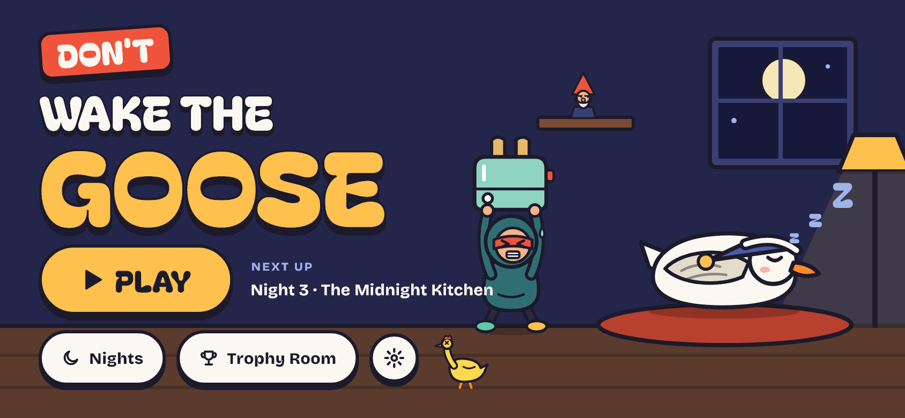
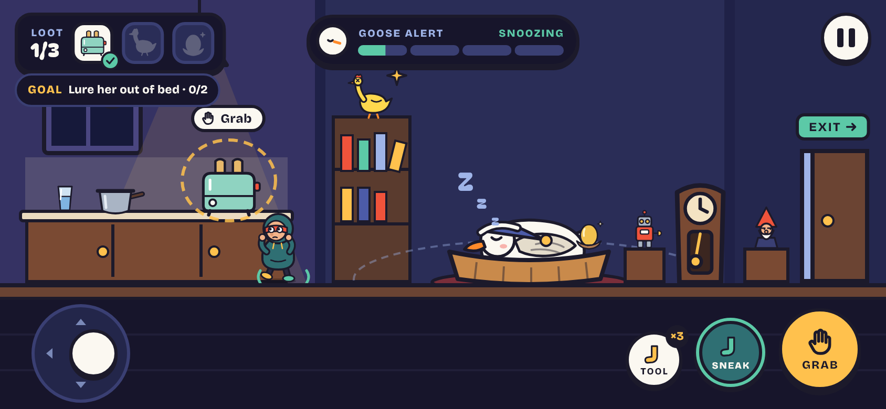
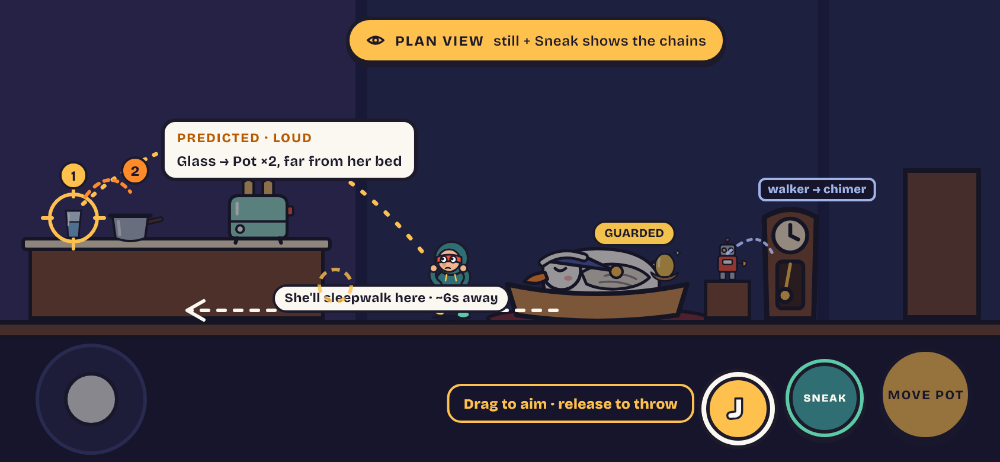
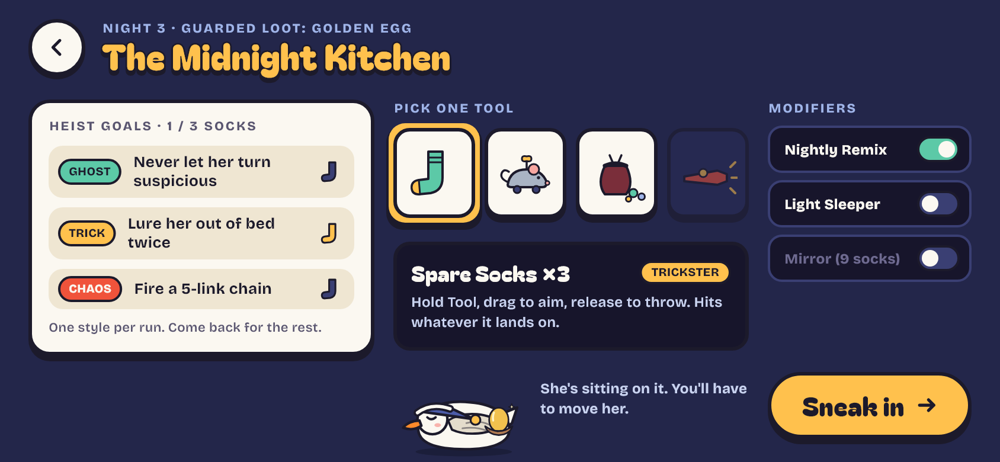
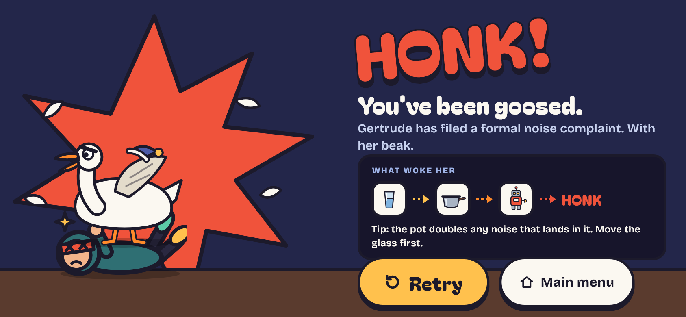

<div align="center">

# Don't Wake the Goose

**Jangan Bangunin Angsa** · a cozy stealth game about very quiet burglary




</div>

You are **Milo Muffle**, a burglar with soft shoes and big ambitions. Somewhere in the house sleeps **Gertrude**, a goose with excellent hearing and a short temper. Grab the loot, slip out the door, and whatever you do: don't wake the goose.

## How it plays

Every sound you make draws rings on the floor. If they reach Gertrude's ear zone, her alert meter climbs:

| Meter | Band | What she does |
| --- | --- | --- |
| 0–24 | Snoozing | Sleeps. Rolls over every 8 seconds. |
| 25–49 | Stirring | Twitches in bed. |
| 50–79 | Suspicious | Half awake and listening. |
| 80–99 | Danger | One more noise and it's over. |
| 100 | Awake | **HONK.** Then the chase. |

The meter drains when the house stays quiet, so patience is a tool. So is chaos.

- **Noise chain reactions.** Knock over a glass and it may tip into a pot, which doubles the noise. A wind-up robot walks off a table and bumps the grandfather clock, which chimes a second later. Chains can lure Gertrude out of bed, or wake her.
- **A goose with a brain.** Gertrude runs a 9-state machine: asleep, stirring, suspicious, sleepwalking, drowsy, awake, chasing, distracted and "lost you". Make her sleepwalk somewhere else, then go for the golden egg she was sitting on.
- **Hide and sneak.** Sneaking halves your speed, but your footsteps go silent and you step over squeaky planks. Break line of sight in a hide spot long enough and she loses track of you.
- **Plan first.** Stand still and sneak to see the chains in the room and where each throw would land.

## Screens

<table>
  <tr>
    <td></td>
    <td></td>
  </tr>
  <tr>
    <td align="center"><sub><b>Gameplay</b> · Night 3, The Midnight Kitchen</sub></td>
    <td align="center"><sub><b>Plan view</b> · see the chain before you start it</sub></td>
  </tr>
  <tr>
    <td></td>
    <td></td>
  </tr>
  <tr>
    <td align="center"><sub><b>Briefing</b> · heist goals, one tool, modifiers</sub></td>
    <td align="center"><sub><b>Caught</b> · the recap shows what woke her</sub></td>
  </tr>
</table>

## Status

Early development. Every screen is laid out from the design, and the game rules run as a headless simulation with tests. Next up is connecting the two.

- [x] Screens laid out at the design's 844×390 artboard
- [x] Headless night simulation: noise meter, chain reactions, goose brain, Night 3 level
- [ ] Simulation driving the gameplay screen
- [ ] Throwing, and tool choice in the briefing
- [ ] Moving objects, hide spots, crawlways
- [ ] Heist goals, style badges (Ghost / Trickster / Chaos), chaos combos
- [ ] Night modifiers, Nightly Remix, saved progress and trophies
- [ ] Launcher icon, splash screen, release build

## Running it

You need the [Flutter SDK](https://docs.flutter.dev/get-started/install) (Dart 3.13 or newer) and an Android device or emulator.

```sh
flutter pub get
flutter run
```

The game is landscape-only. Fonts are bundled, so it runs offline.

## Project layout

```
lib/
├── game/      headless night simulation, pure Dart (no Flutter imports)
├── screens/   one file per screen, laid out on the fixed artboard
├── widgets/   Stage, HUD, controls, buttons
├── art/       inline SVG for the goose, the burglar and props
├── theme/     palette and type
└── state/     game settings
assets/
├── levels/    level data as JSON (night3.json)
└── google_fonts/
test/
├── game/      simulation tests, one file per lib/game file
└── ...        widget tests and a smoke test for every screen
```

There are two layers:

- **`lib/game/`** simulates a night with no Flutter in it. Time only moves through `tick(dt)`, which is split into steps of at most 1/60 s, so one big tick gives the same result as many small ones. The world is one-dimensional: Milo and Gertrude move along the floor line. Levels are JSON files of spots, objects, links and loot. Chains connect *spots* rather than objects, so moving the pot to another spot changes which chains it joins. Every gameplay number lives in `tuning.dart`.
- **The Flutter UI** draws each screen inside `Stage`, a fixed 844×390 canvas that scales to fit the device and letterboxes the rest. Positions are copied from the design one to one.

## Tests

```sh
flutter analyze
flutter test                 # everything
flutter test test/game/      # simulation only
```

The simulation tests play whole nights headlessly. The widget tests render every screen at the artboard size with the real fonts loaded, and fail on any overflow.

## Credits

- Typefaces: [Bagel Fat One](https://fonts.google.com/specimen/Bagel+Fat+One) and [Bricolage Grotesque](https://fonts.google.com/specimen/Bricolage+Grotesque), both under the SIL Open Font License (see `assets/google_fonts/`).
- Built with [Flutter](https://flutter.dev), [flutter_svg](https://pub.dev/packages/flutter_svg) and [google_fonts](https://pub.dev/packages/google_fonts).
